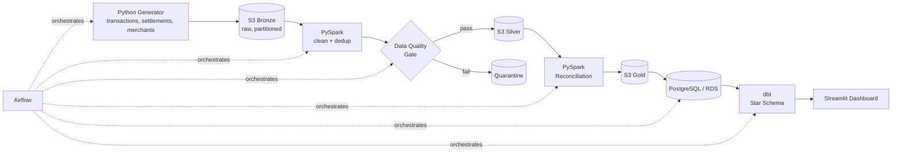

# 💳 Payments Data Platform


Part of my [Data Engineering portfolio](https://github.com/vismaya30/Data_Engineering).

This is an end-to-end batch data platform that ingests synthetic card-payment data, reconciles **authorisations against settlements**, enforces **data quality gates**, and serves analytics through a star-schema warehouse.

It's modelled on real clearing and settlement workflows from the payments industry.

---

## 🎯 Business Problem

Payment processors receive authorisations in real time, but settlement files arrive later (T+1 / T+2). Finance and operations teams need to know three things:

- Which transactions settled correctly?
- Which ones are **unmatched, duplicated or settled with a different amount**?
- What are the daily volumes per merchant, currency and card scheme?

This platform answers those questions with a reliable daily pipeline that is incremental, idempotent and tested.

---

## 🏗️ Architecture



More detail is in [docs/architecture.md](docs/architecture.md).

---

## 🧰 Tech Stack

| Layer | Tools |
|---|---|
| Orchestration | Apache Airflow (Docker) |
| Storage | AWS S3 (bronze / silver / gold) |
| Processing | PySpark |
| Data Quality | Great Expectations / custom checks |
| Warehouse | PostgreSQL (AWS RDS) |
| Modelling | dbt |
| Serving | Streamlit |
| Testing & CI | pytest, ruff, GitHub Actions |

---

## ✨ Key Features

- **Incremental loading.** A watermark-based design processes only new data.
- **Idempotent runs.** Re-running a day overwrites its partition, so no duplicates are created.
- **Data quality gates.** Bad records are quarantined, not loaded.
- **Auth ↔ settlement reconciliation.** Every transaction is classified as matched, unmatched, amount mismatch or late.
- **Late-arriving data.** Settlements arriving up to T+3 are handled.
- **Star schema.** Fact and dimension tables are modelled with dbt.

---

## 📁 Repository Structure

```
payments-data-platform/
├── dags/                  # Airflow DAGs
├── src/
│   ├── generator/         # Synthetic data generator
│   ├── transforms/        # PySpark jobs (silver, gold, reconciliation)
│   ├── quality/           # Data quality checks
│   └── common/            # Config, S3/DB helpers, logging
├── dbt/models/
│   ├── staging/
│   └── marts/             # fact_ and dim_ tables
├── sql/                   # DDL and ad-hoc SQL
├── dashboard/             # Streamlit app
├── tests/                 # pytest unit tests
├── docs/                  # Design documentation
```

---

## 🚀 Quickstart

```bash
git clone https://github.com/vismaya30/Data_Engineering.git
cd Data_Engineering/payments-data-platform
cp .env.example .env          # fill in your values
python -m venv .venv && source .venv/bin/activate
pip install -r requirements.txt
```

Full setup (AWS, Airflow, dbt) is in [docs/setup.md](docs/setup.md).

---

## 📚 Documentation

| Doc | Content |
|---|---|
| [architecture.md](docs/architecture.md) | Layers, data flow, partitioning, idempotency |
| [data_model.md](docs/data_model.md) | Source schemas and star schema |
| [data_quality.md](docs/data_quality.md) | Validation rules and quarantine |
| [reconciliation.md](docs/reconciliation.md) | Matching logic and statuses |
| [decisions.md](docs/decisions.md) | Architecture decision records |
| [setup.md](docs/setup.md) | Local and AWS setup |

---

## 🗺️ Roadmap

- [x] Synthetic data generator
- [x] S3 bronze ingestion + Airflow DAG
- [x] PySpark silver layer (clean, dedup)
- [x] Data quality gate + quarantine
- [x] Reconciliation job (gold)
- [x] Load to PostgreSQL + dbt star schema
- [x] Streamlit dashboard
- [x] Unit tests + CI
- [ ] *Stretch:* Kafka streaming ingestion
- [ ] *Stretch:* Terraform for AWS resources

---

## 👤 Author

**Vismaya** · [LinkedIn](https://linkedin.com/in/<your-profile>) · [GitHub](https://github.com/vismaya30)

## 📄 License

MIT. See [LICENSE](LICENSE).
