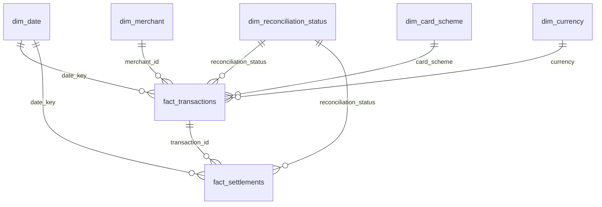

# Data Model

## Source feeds

### Merchants

| Field | Type | Notes |
|---|---|---|
| merchant_id | string | `M00001` style key |
| merchant_name | string | |
| mcc | string | four digit merchant category code |
| country | string | ISO 3166 alpha-2 |
| settlement_currency | string | ISO 4217 |
| onboarded_date | date | |

### Authorisations (transactions)

| Field | Type | Notes |
|---|---|---|
| transaction_id | string | `T` + auth date + sequence |
| merchant_id | string | |
| card_scheme | string | VISA, MASTERCARD, AMEX |
| masked_pan | string | first six and last four digits only |
| amount | decimal(18,2) | |
| currency | string | |
| auth_code | string | null when declined |
| auth_status | string | APPROVED or DECLINED |
| auth_timestamp | timestamp | UTC |

### Settlements

| Field | Type | Notes |
|---|---|---|
| settlement_id | string | |
| transaction_id | string | the authorisation being settled |
| merchant_id | string | |
| card_scheme | string | |
| settled_amount | decimal(18,2) | |
| currency | string | |
| settlement_date | date | date the file arrived |
| batch_id | string | scheme + file date |

## What the generator injects

| Scenario | Rate | Where it shows up |
|---|---|---|
| Declined authorisation | 6% | `NOT_APPLICABLE` in the fact table |
| Settled T+1 / T+2 / T+3 | 82% / 14% / 4% of approvals | `MATCHED` or `LATE` |
| Never settled | 1.5% | `PENDING`, then `UNMATCHED` |
| Settled for a different amount | 1.2% | `AMOUNT_MISMATCH` |
| Settled twice | 0.8% | `DUPLICATE` |
| Settlement with no authorisation | 0.2% of daily volume | `ORPHAN_SETTLEMENT` |
| Broken record | 0.8% | quarantine |
| Exact duplicate row | 1% | removed in silver |

## Warehouse

### Facts

**fact_transactions**: one row per authorisation. Grain is `transaction_id`. Carries the authorised amount, the settled amount, how many settlements were seen, days to settle and the reconciliation status. Built incrementally, reprocessing the last `late_window_days` days on every run.

**fact_settlements**: one row per settlement record, including orphans. Grain is `settlement_id`.

### Dimensions

- **dim_date**: calendar from `calendar_start` to a year ahead, keyed on `yyyymmdd`.
- **dim_merchant**: current merchant attributes.
- **dim_card_scheme**, **dim_currency**, **dim_reconciliation_status**: small reference tables loaded from dbt seeds.

### Aggregates

- **agg_daily_volumes**: counts and values per day, merchant, scheme and currency.
- **agg_daily_reconciliation**: record counts and amount differences per day, merchant, scheme, currency and status. The dashboard reads mostly from here.
