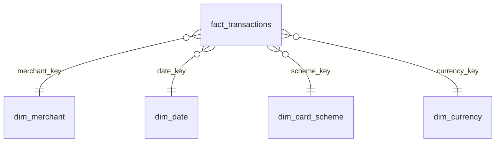

# Data Model

## Source Schemas

### transactions (authorisations)

| Column | Type | Notes |
|---|---|---|
| transaction_id | string | Unique ID (duplicates injected on purpose) |
| card_id | string | Masked card reference |
| merchant_id | string | FK → merchants |
| amount | decimal(12,2) | Authorised amount |
| currency | string | ISO 4217 (EUR, USD, GBP, CHF) |
| card_scheme | string | VISA / MASTERCARD / AMEX |
| status | string | APPROVED / DECLINED |
| auth_timestamp | timestamp | UTC |

### settlements

| Column | Type | Notes |
|---|---|---|
| settlement_id | string | Unique ID |
| transaction_id | string | FK → transactions (may be missing) |
| settled_amount | decimal(12,2) | May differ from authorised amount |
| currency | string | ISO 4217 |
| settlement_date | date | Usually T+1 / T+2, sometimes later |

### merchants

| Column | Type | Notes |
|---|---|---|
| merchant_id | string | Unique ID |
| merchant_name | string | |
| mcc | string | Merchant category code |
| country | string | ISO 3166 |

## Star Schema (dbt marts)

### fact_transactions

| Column | Description |
|---|---|
| transaction_id | Degenerate dimension |
| merchant_key, date_key, scheme_key, currency_key | Surrogate keys |
| auth_amount | Authorised amount |
| settled_amount | Settled amount (nullable) |
| amount_eur | Amount converted to EUR |
| recon_status | MATCHED / AMOUNT_MISMATCH / UNMATCHED_AUTH / UNMATCHED_SETTLEMENT / LATE_MATCH |
| days_to_settle | settlement_date − auth_date |

### Dimensions

- **dim_merchant**: merchant attributes and MCC description
- **dim_date**: calendar attributes (day, week, month, weekday flag)
- **dim_card_scheme**: VISA, MASTERCARD, AMEX
- **dim_currency**: code and EUR conversion rate
